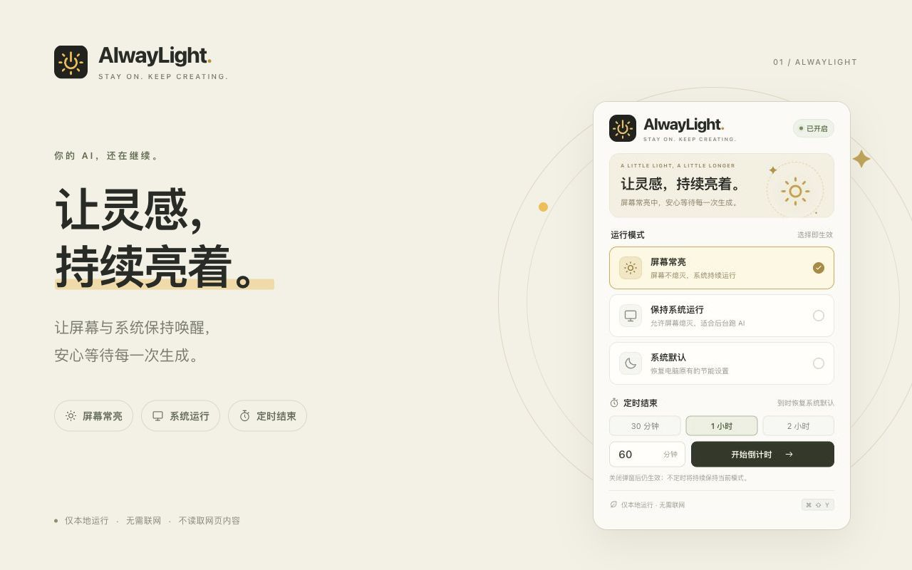

# AlwayLight

让灵感，持续亮着。为长时间 AI 任务准备的轻量 Chrome 扩展。

*Stay on. Keep creating.*



## 功能

| 模式 | 行为 |
| --- | --- |
| 屏幕常亮 | 防止因闲置而关闭或调暗屏幕，同时保持系统运行。 |
| 保持系统运行 | 防止因闲置而让系统休眠，允许屏幕按电脑设置熄灭。 |
| 系统默认 | 释放 AlwayLight 的保持运行请求，恢复电脑原有的电源管理。 |

- 选择模式立即生效，工具栏通过 `ON` / `SYS` 角标显示当前状态。
- 支持 30 分钟、1 小时、2 小时预设，以及 1～1440 整数分钟的自定义倒计时，到时恢复系统默认。
- 取消定时会保留当前模式；切换模式会取消定时。
- 关闭弹窗后继续运行，浏览器重启时恢复上次模式和未结束的定时，已到期则恢复默认。
- 仅在本地运行，无需账户，无联网请求。

## 安装

需要 Chrome 120 或更高版本的桌面浏览器，适用于 macOS、Windows、Linux。

1. 在 [Releases](https://github.com/rockcc20-max/AlwayLight/releases/latest) 页面下载 `alwaylight-1.0.0.zip` 并解压。
2. 在 Chrome 地址栏打开 `chrome://extensions`，开启右上角的「开发者模式」。
3. 点击「加载已解压的扩展程序」，选择解压后包含 `manifest.json` 的文件夹。
4. 在工具栏的拼图菜单中固定 AlwayLight，点击太阳图标即可使用。

也可以下载或克隆本仓库，直接加载仓库根目录。Chrome 应用商店版本已提交审核，并设置审核通过后自动发布；正式上架前请使用上述方式安装。

## 使用说明

先选择「屏幕常亮」或「保持系统运行」，再按需启动倒计时。工具栏没有角标时，表示系统默认状态。

默认快捷键为 macOS 的 `Command+Shift+Y`，Windows / Linux 的 `Ctrl+Shift+Y`，用于在屏幕常亮和系统默认之间切换；处于「保持系统运行」时按下会恢复默认。可在 `chrome://extensions/shortcuts` 中修改。

AlwayLight 防止的是闲置休眠。手动锁屏、合盖、主动睡眠、关机和电量耗尽仍由系统控制。完全退出 Chrome、禁用或卸载扩展后，扩展无法保持电脑运行。网页后台限流、网络超时和 AI 服务本身的任务规则仍然适用。

倒计时由 Chrome 闹钟服务执行，可能受系统调度而延迟；扩展无法唤醒主动睡眠的电脑，唤醒后会处理已到期的定时。「系统默认」仅释放 AlwayLight 自己的请求，其他程序的常亮请求仍可能生效。

## 隐私与权限

仅使用 `power`、`storage`、`alarms` 三项权限，分别用于保持运行、保存本机设置和处理定时。不读取网页、浏览历史或 AI 对话，不上传数据。完整说明见 [隐私说明](PRIVACY.md)。

## 本地开发

需要 Node.js 20 或更高版本，无需安装 npm 依赖。

```sh
# 语法、资源检查与 27 项自动化测试
npm run check

# 生成 dist/alwaylight-1.0.0.zip 与可直接加载的文件夹
npm run package

# 打开交互演示
npm run preview
```

打包脚本需要 `zip` 和 `unzip`，支持配有这些工具的 macOS / Linux 环境。Windows 用户可以直接加载仓库根目录，或在 WSL 中打包。

演示地址为 `http://127.0.0.1:4175`，仅模拟交互，不改变系统电源状态；演示代码不会进入安装包。验证实际常亮行为需在 Chrome 中加载扩展。

Logo 提供可编辑的 [SVG](assets/icon.svg) 与多尺寸 PNG。重新生成 PNG 需 Python 3 与 Pillow，然后运行 `node scripts/render-icons.mjs`。

欢迎通过 Issue 和 Pull Request 参与，见 [贡献指南](CONTRIBUTING.md)；版本记录见 [CHANGELOG.md](CHANGELOG.md)。

## 许可证

使用 [MIT 许可证](LICENSE) 开源，可自由使用、修改和分发，分发时请保留许可与版权声明。
